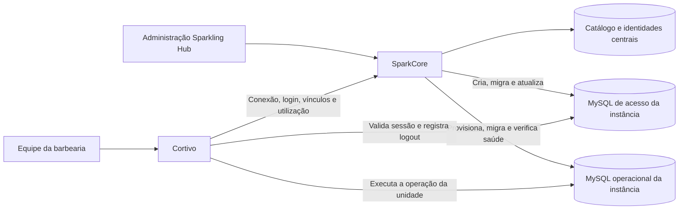

# 02 — Relação com o SparkCore

## Responsabilidades e dados

| Componente | Responsabilidade |
| --- | --- |
| SparkCore | Contratantes, catálogo, conta e identidade, vínculos e convites, ciclo de vida, banco e credencial por instância, migrações, saúde, trilha administrativa e utilização agregada. |
| Cortivo | Configuração operacional da unidade, profissionais e perfis locais, clientes, agenda, fila, atendimentos, vendas, estoque, caixa, comissões, retornos e auditoria de negócio. |
| `spark_core` e `spark_identity` | Bancos centrais sob controle do Core. A aplicação do Cortivo usa contratos para identidade e administração de vínculos. |
| Banco operacional | Exclusivo da instância. O Core tem acesso técnico para provisionar, migrar e verificar saúde. O acesso à operação da barbearia exige vínculo à unidade. |
| Banco de acesso `_acc` | Exclusivo da mesma instância. O Core mantém estado, sessões e projeção de vínculos. A credencial operacional lê a projeção e acrescenta registros de logout em `access_session_logout`. |

## Requisitos de integração

### `CORE-COR-001` [H/P] Catálogo e identidade do produto

Cadastrar o produto por migração do catálogo do Core, com nome de exibição **Cortivo** e código técnico imutável. **`cortivo`** é o código proposto para um cadastro novo e `cortivo_` seu prefixo. A inspeção do catálogo versionado e do registro de provisionadores não identificou `cortivo` ou `sparkbarba` como código registrado. O `sparkbarba` encontrado nos protótipos identifica o produto no site. Em `C00`, verificar o ambiente-alvo e preservar o código e o prefixo se já houver um registro para o produto. Mudança de nome comercial segue migração de nome do catálogo, como em Tuteli/`sparkpet`. Reservar portas locais sem colisão e definir a origem de cada ambiente antes de publicar. [Guia de novo produto no Core](../../../../core/core.sparkilnghub.com.br/docs/operacao/novo-produto.md).

### `CORE-COR-002` [H] Provisionar, migrar e ativar

O administrador da plataforma com a autorização requerida cadastra ou escolhe o contratante, solicita uma instância Cortivo e acompanha o protocolo. O provisionador cria o banco de operação e o banco `_acc` a partir do mesmo UUID, registra a propriedade e aplica o artefato de cada responsável. Com a instância `PRONTA`, o administrador pode emitir o convite inicial e seguir o fluxo de ativação do Core. A emissão também é elegível em `ATIVA` enquanto não houver administrador ativo e o convite inicial ainda puder ser aceito. A operação autenticada exige sessão em instância ativa. Repetição de solicitação e retomada depois de falha reutilizam apenas recursos cuja propriedade foi comprovada.

O Cortivo entrega manifesto v1 com `productCode`, `databasePrefix`, migrações contíguas e SHA-256, com a tabela `_spark_instance` na primeira migração. O Core registra o provisionador e o caminho em código, controla permissões MySQL, aplica migrações do produto e mantém seu próprio artefato para `_acc`. O processo operacional usa credencial de alcance restrito, sem privilégios de provisionamento. Antes de aceitar tráfego, validar a identidade da instância e a faixa de versões de esquema suportada. [Contrato do artefato](../../../../core/core.sparkilnghub.com.br/contracts/migration-artifact.md).

### `CORE-COR-003` [H/P] Resolver instância e conexão

No primeiro piloto, propõe-se um processo lógico por instância, configurado com `SPARKCORE_INSTANCE_SLUG`, como no guia do Tuteli. O backend resolve o slug de configuração e usa `GET /internal/v1/instances/{slug}/connection`, com credencial de aplicação `connection`. A resposta traz `instanceId`, `state`, fuso, `database`, `accessDatabase`, usuário, senha e versão da credencial. Usar a identidade devolvida pelo Core e confrontá-la com os marcadores dos bancos. Manter os segredos somente em memória no servidor, com pools vinculados à identidade e à versão da credencial. Substituir pools ao atualizar a conexão e descartar os anteriores de forma ordenada. Rotas, cabeçalhos, cookies e payloads do navegador são entradas a validar. A política de roteamento por domínio e a topologia para várias instâncias são decisões de planejamento. [Conexão no OpenAPI](../../../../core/core.sparkilnghub.com.br/contracts/openapi.yaml) · [Guia do Tuteli](../../../../tuteli/tuteli.sparklinghub.com.br/docs/operacao/configurar-instancia.md).

### `CORE-COR-004` [H] Identidade central e autorização local

O navegador entra pela interface do Cortivo e o backend usa `POST /internal/v1/instances/{slug}/sessions`, escopo `sessions`. O Core valida conta, senha, vínculo e estado, grava a sessão na projeção e emite token opaco. O Cortivo usa cookie com escopo apropriado, `Secure` em ambiente TLS e `HttpOnly`. Mantém credencial de aplicação e token fora de logs, armazenamento acessível a scripts e respostas operacionais. A cada operação protegida, o backend aplica a validação normativa de `_acc` e usa `membership_id` e papel resultantes. O perfil local restringe ações do colaborador. Logout escreve pelo mecanismo do contrato e limpa o cookie. Enviar `sessions/touch` no máximo uma vez a cada cinco minutos por sessão, como atualização de inatividade. A projeção vigente define teto de 12 h e inatividade de 2 h. [ADR D-04](../../../../core/core.sparkilnghub.com.br/docs/adr/0004-autorizacao-sincrona.md) · [Contrato da projeção v2](../../../../core/core.sparkilnghub.com.br/contracts/access-projection.md).

### `CORE-COR-005` [H] Equipe, convite e recuperação

O administrador da unidade administra membros via rotas internas versionadas de membros e convites. O servidor usa escopo `members` e a sessão válida do ator sempre que o contrato exigir. Core mantém a regra do último administrador, identidade global e convites e recuperação de uso único. O Cortivo cadastra profissionais e associa perfis a vínculos válidos dentro do próprio banco. O planejamento confirma a experiência de aceite de convite e o canal de entrega com o fluxo publicado pelo Core.

### `CORE-COR-006` [H] Ciclo de vida, falhas e continuidade

- Suspensão, manutenção, revogação de vínculo, bloqueio de conta e troca de senha alcançam sessões já abertas conforme a regra da projeção. Em suspensão e reativação, o Core controla a revisão e a reativação exige novo login. Vincular uma pessoa em A e B permite revogar A preservando B quando a ação é restrita à instância. Instância inacessível mantém a sincronização pendente no Core com tentativa posterior.
- Sessão inválida recebe `401` seguro. Sessão válida sem permissão recebe `403`. Instância ou recurso fora do contexto recebe resposta que preserve o sigilo de sua existência. Ao perder acesso à projeção, conexão ou versão de esquema compatível, recusar operação protegida com indisponibilidade. Sem Core, uma sessão já válida pode seguir com conexão e projeção acessíveis até expirar ou ser revogada. Login, convites e atualização de vínculo ficam temporariamente indisponíveis. Uma inicialização a frio sem conexão resolvida fica indisponível.
- Se uma transação já passou pela autorização antes da suspensão, pode concluir e a ordem deve ser demonstrável por correlação. A autorização iniciada após a projeção refletir a suspensão recusa a ação. Tarefas de negócio em segundo plano devem verificar estado da instância antes de executar efeitos novos.
- Backup, restauração isolada e reconciliação de acesso seguem o Core. Na volta da unidade, verificar dados, versão e projeção atual e invalidar sessões restauradas antes de liberar. Validar que usuário revogado continua sem acesso e que outra instância não sofre alteração. [Operação de backup e restauração](../../../../core/core.sparkilnghub.com.br/docs/operacao/backup-restauracao.md).

### `CORE-COR-007` [H/P] Utilização agregada

Quando o suporte F08 estiver homologado na base-alvo, enviar pela fila persistente de saída do Cortivo, criada junto da transação de negócio. Usar `POST /internal/v1/instances/{instanceId}/usage-batches` com credencial vinculada à instância e escopo `utilizacao`. Usar `batch_id` e `event_id` estáveis, `occurred_at` em UTC, `kind` e `count`. Começar por `atendimentos_iniciados`, `atendimentos_concluidos` e `vendas_confirmadas`, já reconhecidos pelo Core. Para cada transição efetiva, emitir uma ocorrência com `count = 1`. A repetição do lote ou reagrupamento de um evento mantém seu ID. Permitir retentativa com limite, observação de atraso e tratamento de rejeição de contrato. Entregar contagens e contexto mínimo de instância, sem nomes de clientes, profissionais, valores, itens ou observações. A falha de envio preserva operações concluídas. A métrica de usuários ativos só entra após definir janela e deduplicação. Há rota e testes no código local do Core. A disponibilidade no ambiente do Cortivo depende da validação em `C00`. [Contrato F08](../../../../core/core.sparkilnghub.com.br/specs/005-f08-core-auditoria-utilizacao/contracts/openapi-f08.yaml).

### `CORE-COR-008` [H/P] Compatibilidade e verificação

Usar monólitos modulares independentes, APIs versionadas, MySQL 8.4, React/TypeScript/Tailwind, servidor Node.js e o design system do hub. O framework, as versões exatas e a estrutura de deploy do Cortivo ficam no `plan.md`. A integração tem testes próprios em MySQL real com duas instâncias Cortivo e prova de compatibilidade com o produto de referência e com Tuteli. O middleware atual do Tuteli usa `sessions/touch` como guarda síncrona. Para o Cortivo, a fonte normativa é a validação local de D-04. O plano de `C01` exercita consulta protegida com sessão válida e Core fora do ar, seguida de revogação efetivada e nova negativa. [Constituição do Core](../../../../core/core.sparkilnghub.com.br/.specify/memory/constitution.md) · [Middleware do Tuteli](../../../../tuteli/tuteli.sparklinghub.com.br/api/src/middleware/require-auth.ts).
