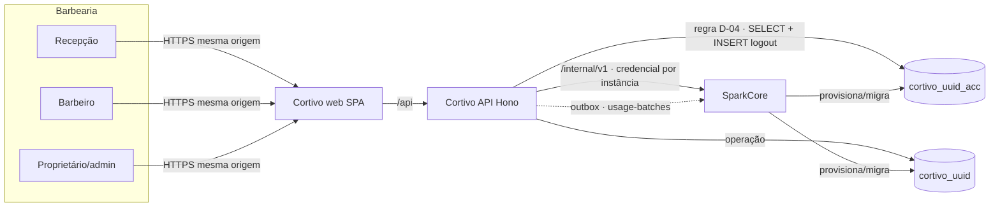

# 01 — Arquitetura, módulos e permissões

Modelagem preliminar sobre o [escopo](../escopo/README.md), aplicando os padrões canônicos do
SparkCore (`core/core.sparkilnghub.com.br/docs/ecossistema/`). Onde a modelagem escolhe entre
alternativas, a escolha está marcada com a decisão `D-COR-*` correspondente.

## Identificação

| Item | Valor | Fonte |
| --- | --- | --- |
| Nome comercial | Cortivo | `UX/marcas-produtos.md` |
| Código técnico | `cortivo` | D-COR-01, `ECO-001.2` |
| Prefixo de banco | `cortivo_` (operacional `cortivo_<uuid>`, acesso `cortivo_<uuid>_acc`) | `ECO-001.3` |
| Portas locais | API **3003**, Vite **5177** | `ECO-002` |
| Core em desenvolvimento | `http://127.0.0.1:5273` | `ECO-002.2` |
| Marca | `UX/assets/logomarcas-produtos/final-v1/cortivo/` (navalha, opção B) | `UI-050` |
| Design system | `@sparkling-hub/design-system` 0.5.0 | `UI-001` |
| Stack | Node 22 · Hono · Kysely · mysql2 · MySQL 8.4 · React 19 · React Router 7 · TanStack Query 5 · Vite 7 · Tailwind 4 | `ECO-011` |

## Contexto

## Módulos da API (`api/src/modules/`)

| Módulo | Responsabilidade | Requisitos | Fatia |
| --- | --- | --- | --- |
| `acesso` (`core/`, `middleware/`) | Boot, conexão, login, projeção, touch, logout, perfil local | `CORE-COR-001..006`, `INT-*`, `SEC-BASE-*` | C01 |
| `unidade` | Configuração da unidade, horários, parâmetros (tolerância, passo da agenda), histórico, prontidão | `COR-001` | C02 |
| `equipe` | Proxy dos membros/convites do Core; profissionais; perfis locais; habilitação por serviço | `COR-004`, `CORE-COR-005` | C02 |
| `clientes` | Cadastro, busca, preferências de contato, histórico | `COR-002` | C02 |
| `catalogo` | Serviços, itens de revenda/insumo | `COR-003` | C02 |
| `disponibilidade` | Expediente, pausas, bloqueios; cálculo de janelas livres (puro) | `COR-004`, `COR-005` | C02/C03 |
| `agenda` | Reservas, remarcação, cancelamento, chegada, falta | `COR-005`, `COR-006` | C03 |
| `fila` | Entradas, ordem, prioridade, encaixe | `COR-007`, `COR-008` | C04 |
| `atendimento` | Visão Hoje, início, itens adicionais, conclusão, interrupção, consumo | `COR-009`, `COR-010` | C04 |
| `comercial` | Comandas, rateio de desconto, confirmação, cancelamento, refaturamento | `COR-011`, `COR-014` | C05/C06 |
| `caixa` | Turno, recebimentos, troco, suprimento, sangria, estorno, fechamento | `COR-012..014` | C05 |
| `estoque` | Saldos, extrato, entrada, ajuste, consumo, reposição | `COR-015` | C06 |
| `comissoes` | Regras, lançamentos na quitação/estorno, competência, extrato | `COR-016`, `COR-017` | C07 |
| `retornos` | Sugestões, contato manual, adiamento, dispensa | `COR-018` | C08 |
| `relatorios` | Indicadores, CSV seguro | `COR-019` | C08 |
| `auditoria` | Trilha só-inserção e consulta | `COR-020` | C02→C08 |
| `utilizacao` | Outbox e trabalhador F08 | `CORE-COR-007` | C09 |
| `fornecedores`, `mensagens` | Evolução | `COR-021..024` | C11/C12 |

Regras puras (sem I/O) e testadas em unidade: `disponibilidade/janelas.ts`,
`fila/ordenacao.ts`, `comercial/rateio.ts`, `comissoes/apuracao.ts`, `caixa/esperado.ts`,
`retornos/sugestao.ts`, `comum/tempo.ts` (fuso, `[início, fim)`, horário inexistente/ambíguo).

## Papéis e perfis

O Core concede `administrador` ou `colaborador`. O Cortivo associa ao `membership_id` do
colaborador um ou mais **perfis locais** (`ECO-014`). **D-COR-03 decidida (15/11/2026): perfis
acumuláveis** — um vínculo pode ter `recepcao` e `barbeiro` ao mesmo tempo, e as permissões são a
**união** das colunas da matriz abaixo.

| Perfil efetivo | Origem |
| --- | --- |
| Administrador | papel `administrador` na projeção (dispensa perfil local) |
| Recepção | `colaborador` + perfil `recepcao` |
| Barbeiro | `colaborador` + perfil `barbeiro` + exatamente 1 profissional ativo associado |
| Recepção + barbeiro | `colaborador` + ambos; opera a unidade como recepção e vê comissão só do próprio profissional |
| Pendente | `colaborador` sem perfil → tela "Configuração pendente" (sem operação) |

Administrador que também corta cabelo é cadastrado como profissional com `membership_id`
associado; seus atendimentos aparecem no extrato dele.

### Matriz de ações (servidor)

| Ação | Admin | Recepção | Barbeiro |
| --- | --- | --- | --- |
| Configurar unidade, catálogo, expedientes, bloqueios, regras | ✔ | leitura | leitura do necessário |
| Convidar/mudar papel/revogar (via Core) | ✔ | — | — |
| Definir perfil local e associar profissional | ✔ | — | — |
| Clientes: criar, editar, inativar | ✔ | ✔ | leitura dos próprios atendidos |
| Reservar, remarcar, cancelar, chegada, falta | ✔ | ✔ | leitura da própria agenda |
| Fila e encaixe | ✔ | ✔ | — |
| Iniciar/concluir/interromper atendimento | ✔ | ✔ | somente os próprios |
| Adicionar item em atendimento em curso | ✔ (autoriza) | ✔ (autoriza) | solicita |
| Abrir/fechar caixa, vender, receber | ✔ | ✔ | — |
| Desconto (inclusive gratuidade) | ✔ com motivo | — (D-COR-05 decidida) | — |
| Estornar, cancelar venda, ajustar estoque, fechar competência | ✔ com motivo | — | — |
| Consumo de insumo | ✔ | ✔ | atendimento próprio em curso |
| Relatórios e CSV | ✔ todos | dia e caixa operacional | própria agenda e comissão, sem CSV |
| Retornos e contato | ✔ | ✔ | — |
| Auditoria | ✔ | — | — |

Implementação: `requireRole('administrador')`, `requirePerfil('recepcao'|'barbeiro')` e regra de
propriedade no serviço (`profissional_id` do barbeiro = profissional do objeto). Negação de objeto
de outro profissional → `404` (não revela existência) quando o barbeiro não poderia sabê-la; `403`
quando a tela já o exibe.

## Fluxos críticos e transações

| Fluxo | Bloqueios (MySQL `SELECT … FOR UPDATE`) | Efeitos atômicos |
| --- | --- | --- |
| Reservar/remarcar/encaixe/iniciar | linha `profissional` + linha `cliente` (ordem por id) | inserir/alterar `agendamento`, itens; no encaixe, `fila_entrada → convertido` |
| Confirmar comanda | `comanda`; `estoque_saldo` dos itens (ordem por id); `caixa_turno` se balcão anônimo | itens, rateio, `faturamento_servico`, baixas, (recebimento), outbox `vendas_confirmadas` |
| Receber/estornar | `comanda`, `caixa_turno` | `recebimento`, efeito em `comissao_lancamento` na quitação/estorno |
| Fechar caixa | `caixa_turno` | foto do turno, diferença, justificativa |
| Fechar competência | `comissao_competencia` | totais congelados por profissional |

Serializar por **profissional** e **cliente** (não por faixa de horário) é a estratégia proposta
para `[início, fim)` sem `EXCLUDE` constraint no MySQL; a prova com requisições paralelas em MySQL
real é critério de C03 (`AC-COR-005/006`).

## Eventos de utilização (C09)

| `kind` | Origem (mesmo commit) |
| --- | --- |
| `atendimentos_iniciados` | início de atendimento |
| `atendimentos_concluidos` | conclusão |
| `vendas_confirmadas` | confirmação de comanda |
| `atividade_autenticada` *(proposto, exige cadastro no Core)* | primeira requisição protegida do dia por vínculo |
