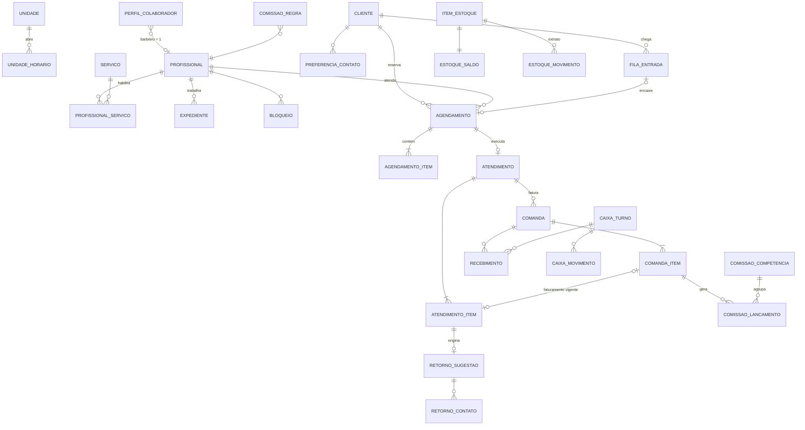

# 02 — Modelo de dados (banco operacional `cortivo_<uuid>`)

Modelo físico **preliminar** para o artefato `core/.../produtos/cortivo/artifact/`. O `plan.md`
de cada fatia confirma tipos, índices e a migração em que a tabela nasce. Convenções:

- PK `BINARY(16)` com UUID v7 (ordenável); `version INT UNSIGNED` em registros editáveis.
- Instantes `DATETIME(6)` UTC com sufixo `_em`; datas civis `DATE` com sufixo `_data`.
- Dinheiro `BIGINT` em centavos com sufixo `_cents` (nunca `DECIMAL`/float no cálculo).
- Quantidade de estoque `BIGINT` em **milésimos** da unidade (`_mil`), precisão fixa por item.
- Taxas em pontos-base `INT` (`_bp`; 40% = 4000).
- Referências a pessoas da plataforma (`membership_id`, `account_id`) são UUIDs opacos do Core,
  sem FK entre bancos (`ECO-013`).
- "Único entre vigentes" usa coluna gerada `ativo_chave = IF(estado='x', chave, NULL)` com
  `UNIQUE`, já que o MySQL não tem índice parcial.

## Diagrama

## Tabelas

### Infraestrutura (migração 0001 — C00, publicada no Core: spec 009)

Artefato publicado em `core/produtos/cortivo/artifact/` (`0001_base`, manifesto v1,
`appendOnlyTables: ["auditoria"]`). **Onde o contrato do Core prevalece sobre esta modelagem:** o
marcador usa o formato do contrato do artefato, e `unidade` e `perfil_colaborador` já nascem na
0001. A migração `0002` (C01) acrescenta `profissional` e a integridade do perfil barbeiro.

| Tabela | Colunas essenciais | Restrições |
| --- | --- | --- |
| `_spark_instance` | `instance_uuid`, `product_code`, `owner_task_uuid`, `synthetic`, `created_at` (formato do contrato do Core, igual ao do Tuteli) | linha única; conferida no boot (`INT-010`) |
| `idempotencia` | `chave`, `ator_membership_id`, `operacao`, `resumo_sha256`, `status_http`, `resposta_json`, `criado_em`, `expira_em` | PK (`chave`,`ator`,`operacao`); limpeza > 24 h |
| `auditoria` | `id`, `ocorrido_em`, `ator_membership_id`, `ator_nome`, `acao`, `resultado`, `entidade`, `entidade_id`, `motivo`, `antes_json`, `depois_json`, `correlation_id CHAR(36)` | **só-inserção** (`SEC-BASE-12`); sem dados pessoais completos |
| `outbox_evento` | `event_id`, `kind`, `count`, `occurred_at`, `batch_id`, `estado`, `tentativas`, `proxima_tentativa_em` | `event_id` único |
| `unidade` (0001) | `id` (sempre 1), `nome_atendimento`, `telefone`, `whatsapp`, `email`, `cep`, `logradouro`, `numero`, `complemento`, `bairro`, `cidade`, `uf`, `fuso` (do Core), `tolerancia_falta_min` (padrão **15**, D-COR-04), `passo_agenda_min` (padrão **15**; aceita 5/10/15/20/30), `version` | **linha única** (`CHECK id = 1`); nasce vazia, gravada pelo Cortivo na C02 |
| `perfil_colaborador` (0001) | `membership_id` PK, `perfis` SET(`recepcao`,`barbeiro`), `profissional_id` NULL (sem FK), `definido_por`, `version` | perfis acumuláveis e não vazios (D-COR-03, `CHECK perfis <> ''`); a regra "barbeiro ⇒ `profissional_id` NOT NULL e único entre vínculos vigentes" entra na 0002, junto com `profissional`; histórico na `auditoria` |

### Unidade e equipe (C02; `profissional` chega na 0002 da C01)

| Tabela | Colunas essenciais | Restrições |
| --- | --- | --- |
| `unidade_horario` | `dia_semana`, `inicio`, `fim` | intervalos sem sobreposição por dia |
| `profissional` | `id`, `nome`, `apelido`, `telefone`, `estado` (`ativo`/`inativo`), `membership_id` NULL, `cor_agenda` (token), `version` | `membership_id` único entre ativos |
| `profissional_servico` | `profissional_id`, `servico_id` | PK composta |
| `expediente` | `profissional_id`, `dia_semana`, `inicio`, `fim` | pausas = lacunas entre intervalos |
| `bloqueio` | `id`, `profissional_id` NULL (= unidade), `inicio_em`, `fim_em`, `motivo`, `estado` | `[início, fim)`; conflito com reserva vigente bloqueia gravação |

### Clientes e catálogo (C02)

| Tabela | Colunas essenciais | Restrições |
| --- | --- | --- |
| `cliente` | `id`, `nome`, `telefone_e164` NULL, `telefone_busca` (dígitos), `email` NULL, `data_nascimento` DATE NULL, `observacoes` (≤ 280), `profissional_preferido_id`, `estado`, `version` | índice em `telefone_busca` **não único** (telefone compartilhado); e-mail e nascimento opcionais (D-COR-09); **sem CPF** no MVP |
| `preferencia_contato` | `cliente_id`, `canal` (`whatsapp`,`telefone`,`sms`), `finalidade` (`confirmacao`,`lembrete`,`retorno`), `permitido`, `origem`, `registrado_em`, `ator` | histórico append-only; vigente = último por (cliente, canal, finalidade) |
| `servico` | `id`, `nome`, `duracao_min` > 0, `preco_cents` ≥ 0, `cadencia_retorno_dias` NULL, `estado`, `version` | — |
| `item_estoque` | `id`, `nome`, `unidade_medida` (`un`,`ml`,`g`), `casas_decimais` (0–3), `uso` SET(`revenda`,`insumo`), `preco_venda_cents` NULL, `saldo_minimo_mil`, `estado`, `version` | unidade/precisão imutáveis após 1º movimento |

### Agenda, fila e atendimento (C03/C04)

| Tabela | Colunas essenciais | Restrições |
| --- | --- | --- |
| `agendamento` | `id`, `cliente_id`, `profissional_id`, `inicio_em`, `fim_em`, `estado` (`reservado`,`chegou`,`em_atendimento`,`concluido`,`interrompido`,`cancelado`,`falta`), `origem` (`agenda`,`encaixe`), `fila_entrada_id` NULL único, `chegada_em`, `motivo`, `criado_por`, `version` | sem sobreposição por profissional e por cliente entre vigentes (validação serializada) |
| `agendamento_item` | `agendamento_id`, `ordem`, `servico_id`, `nome_snapshot`, `duracao_min_snapshot`, `preco_cents_snapshot` | `fim_em = inicio_em + Σ duração` |
| `fila_entrada` | `id`, `cliente_id`, `chegada_em` (servidor), `profissional_preferido_id`, `prioridade_ajuste` INT, `motivo_ajuste`, `estado` (`aguardando`,`convertido`,`desistiu`,`cancelado`), `agendamento_id`, `version` | uma `aguardando` por cliente (coluna gerada + UNIQUE) |
| `fila_entrada_item` | `fila_entrada_id`, `servico_id` | — |
| `atendimento` | `id`, `agendamento_id` UNIQUE, `profissional_id`, `cliente_id`, `iniciado_em`, `encerrado_em`, `estado` (`em_atendimento`,`concluido`,`interrompido`), `motivo_interrupcao` | 1 em curso por profissional e por cliente (colunas geradas + UNIQUE) |
| `atendimento_item` | `id`, `atendimento_id`, `servico_id`, `nome_snapshot`, `preco_cents`, `duracao_min`, `cadencia_dias_snapshot`, `comissao_bp_snapshot`, `executado` BOOL, `adicionado_por`, `autorizado_por` | regra de comissão congelada na inclusão |

### Comercial, caixa e estoque (C05/C06)

| Tabela | Colunas essenciais | Restrições |
| --- | --- | --- |
| `comanda` | `id`, `tipo` (`atendimento`,`balcao`), `cliente_id` NULL, `atendimento_id` NULL, `estado` (`rascunho`,`confirmada`,`cancelada`), `bruto_cents`, `desconto_cents`, `total_cents`, `motivo_desconto`, `autorizado_desconto_por`, `confirmada_em`, `confirmada_por`, `refatura_de_id`, `version` | `cliente_id` obrigatório se saldo > 0 após confirmação |
| `comanda_item` | `id`, `comanda_id`, `tipo` (`servico`,`produto`), `atendimento_item_id` NULL, `item_estoque_id` NULL, `quantidade_mil`, `preco_unit_cents`, `bruto_cents`, `desconto_rateado_cents`, `liquido_cents` | rateio determinístico (maiores restos, desempate por id) |
| `faturamento_servico` | `atendimento_item_id`, `comanda_item_id`, `vigente_chave` (gerada) | UNIQUE `vigente_chave` ⇒ 1 venda confirmada vigente por item executado |
| `caixa_turno` | `id`, `aberto_em`, `aberto_por`, `fundo_cents`, `fechado_em`, `fechado_por`, `contado_cents`, `esperado_cents`, `diferenca_cents`, `justificativa`, `totais_json`, `estado` | 1 `aberto` por unidade (gerada + UNIQUE); imutável após fechar |
| `caixa_movimento` | `id`, `turno_id`, `tipo` (`suprimento`,`sangria`), `valor_cents`, `motivo`, `ator`, `ocorrido_em` | só-inserção |
| `recebimento` | `id`, `comanda_id`, `turno_id`, `meio` (`dinheiro`,`pix`,`cartao_credito`,`cartao_debito`), `valor_cents` > 0, `troco_cents`, `recebido_em`, `ator`, `estorno_de_id` UNIQUE NULL, `motivo` | estorno = linha inversa no turno aberto, meio original |
| `estoque_saldo` | `item_id` PK, `quantidade_mil` ≥ 0, `version` | CHECK ≥ 0 |
| `estoque_movimento` | `id`, `item_id`, `tipo` (`entrada`,`venda`,`consumo`,`reposicao_cancelamento`,`ajuste`,`entrada_pedido`), `quantidade_mil` (±), `origem_tipo`, `origem_id`, `chave_negocio` UNIQUE, `motivo`, `ator`, `ocorrido_em` | saldo = Σ extrato (reconciliação testada) |

### Comissões e retornos (C07/C08)

| Tabela | Colunas essenciais | Restrições |
| --- | --- | --- |
| `comissao_regra` | `id`, `profissional_id`, `servico_id` NULL, `taxa_bp`, `vigente_de`, `vigente_ate` NULL | sem sobreposição de vigência por (profissional, serviço) |
| `comissao_lancamento` | `id`, `profissional_id`, `comanda_item_id`, `tipo` (`quitacao`,`estorno`), `base_cents`, `taxa_bp`, `valor_cents` (±), `competencia` CHAR(7) `AAAA-MM`, `ocorrido_em`, `referencia_id`, `chave` UNIQUE | só-inserção |
| `comissao_competencia` | `competencia`, `profissional_id`, `estado` (`aberta`,`fechada`), `total_cents`, `fechada_em`, `fechada_por` | fechamento só após fim do mês civil local |
| `retorno_sugestao` | `id`, `cliente_id`, `servico_id`, `atendimento_item_id`, `data_sugerida`, `adiada_para`, `estado` (`sugerido`,`adiado`,`agendado`,`dispensado`,`substituido`), `agendamento_id`, `motivo`, `corrente_chave` (gerada) | 1 corrente por (cliente, serviço) |
| `retorno_contato` | `id`, `sugestao_id`, `canal`, `ator`, `contato_em`, `resultado` | sem conteúdo de conversa |

### Evolução (C11/C12)

`fornecedor`, `pedido`, `pedido_item`, `pedido_recebimento`, `mensagem`, `mensagem_evento` —
conforme [escopo 04](../escopo/04-dados-e-contratos.md), modeladas na fatia correspondente.

## Exemplo de comissão (verificação de `comercial/rateio.ts` + `comissoes/apuracao.ts`)

Serviço 10000, produto 2000, desconto 1200 → rateio: serviço 1000, produto 200 → líquidos 9000 e
1800. Taxa 4000 bp → comissão 3600 **apenas** na quitação de 10800. Recebimentos 4000 + 6800 →
lançamento `quitacao` 3600 na competência da data do segundo recebimento. Estorno de 6800 →
lançamento `estorno` −3600 na competência corrente (`AC-COR-014`).
