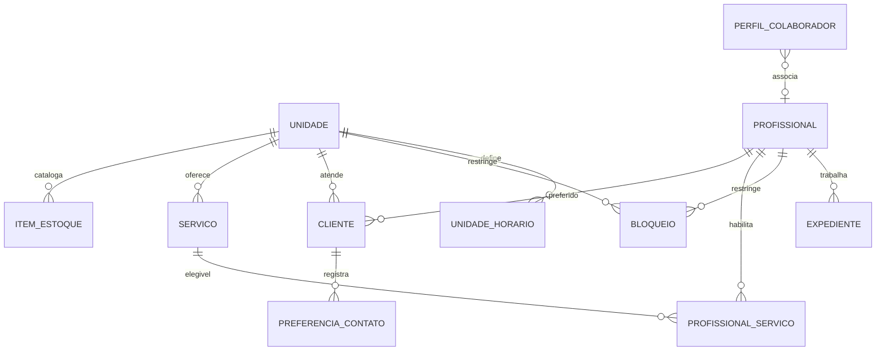

# Data Model — 002 Unidade e cadastros do Cortivo (C02)

Modelo lógico para C02, compatível com as convenções de
[modelagem 02](../../docs/modelagem/02-modelo-de-dados.md). O banco operacional é exclusivo da
instância. As entidades de C01 (`unidade`, `perfil_colaborador`, `profissional` e `auditoria`)
continuam sendo a base; a migração de C02 estende o esquema anterior sem regravar fatos históricos.

## Convenções e limites

- PK de negócio: `BINARY(16)` UUID v7; referências da plataforma (`membership_id`, `account_id`)
  são UUIDs opacos, sem FK entre bancos.
- Instantes: `DATETIME(6)` UTC com sufixo `_em`; horários semanais são horas locais da unidade
  (`TIME`); datas civis são `DATE`.
- Moeda: `BIGINT` em centavos; quantidade: milésimos em `BIGINT`.
- Registros editáveis têm `version INT UNSIGNED`; atualização exige a versão lida e retorna
  conflito quando ela mudou.
- Cadastros usados são inativados, não removidos. Todas as leituras e escritas se limitam ao banco
  da instância validada em C01.
- Auditoria é append-only; não incluir segredo, contato completo ou conteúdo integral de observação
  nos snapshots. O registro de auditoria e a mutação correspondente compartilham a transação.
- A numeração prevista da migração C02 é `0003_cadastros`, depois das versões 0001/0002; o Core
  confirma e publica a versão definitiva do artefato antes da implementação.

## Entidades

### Unidade (`unidade`)

Linha única por instância (`id = 1`); recebe identidade/fuso do Core e configuração de atendimento
local.

| Campo lógico | Representação | Regra |
| --- | --- | --- |
| Identidade e fuso de origem | código da instância e fuso IANA já validado em C01 | leitura da origem central; não aceitar identidade enviada como autoridade |
| Nome de atendimento | texto limitado | editável pelo administrador |
| Telefone, WhatsApp, e-mail | textos normalizados, opcionais conforme a política de cadastro | telefone formatado no campo e normalizado para persistência |
| Endereço | CEP, logradouro, número, complemento, bairro, cidade, UF | CEP validado e armazenado sem máscara |
| Parâmetros operacionais | tolerância de falta e passo de agenda em minutos | padrões 15/15; tolerância inteira não negativa; passo em 5, 10, 15, 20 ou 30 |
| `version` | inteiro sem sinal | controle otimista; todo update exige versão vigente |

O nome e fuso da instância são apresentados com a origem central identificada. O fuso não é
editável em operação corrente; qualquer mudança futura requer fluxo explícito e avaliação da
agenda e dos relatórios.

### Horário de unidade (`unidade_horario`)

Um ou mais intervalos por dia da semana, pertencentes à unidade única.

| Campo lógico | Representação | Regra |
| --- | --- | --- |
| Dia da semana | enum/inteiro padronizado | dia civil semanal |
| Início e fim | `TIME` | início < fim; fim exclusivo; sem sobreposição no mesmo dia |
| Referência à unidade | constante `id = 1` ou chave equivalente | não existe outra unidade na instância |

Um dia sem linha cadastrada não abre. Substituição de horários valida o conjunto completo antes de
persistir, para que não haja salvamento parcial de intervalos inválidos.

### Profissional (`profissional`)

Representa a pessoa operacional; pode não ter conta na plataforma.

| Campo | Tipo/forma lógica | Regra |
| --- | --- | --- |
| `id` | UUID v7 binário | PK estável |
| `nome` | texto | obrigatório, aparado e validado |
| `apelido` | texto opcional | rótulo curto |
| `telefone_e164` | telefone normalizado opcional | entrada bruta de 10–11 dígitos para número brasileiro |
| `membership_id` | UUID opaco opcional | referência do Core, sem FK; único entre vínculos ativos quando presente |
| `cor_agenda` | token semântico opcional | não usado para comunicar estado sem texto |
| `estado` | `ativo` / `inativo` | padrão ativo; inativar em vez de excluir |
| `version` | inteiro sem sinal | controle otimista |
| `criado_em`, `atualizado_em` | UTC | mantidos pelo servidor |

Não inativar enquanto houver perfil de barbeiro vigente ou reserva impactada sem resolução
explícita. Reativação não restaura automaticamente associação de perfil desfeita.

Quando houver um vínculo autenticado, `profissional.membership_id` e
`perfil_colaborador.profissional_id` devem representar a mesma associação. O valor da referência
central é lido/validado pela projeção; nunca é escolhido como autoridade pelo formulário.

### Perfil local (`perfil_colaborador`)

Entidade originada em C01, mantida em C02 para garantir coerência das permissões.

| Campo | Representação | Regra |
| --- | --- | --- |
| `membership_id` | UUID opaco do Core | PK; vínculo precisa continuar ativo e ser `colaborador` na projeção |
| `perfis` | conjunto `recepcao`, `barbeiro` | pelo menos um perfil; podem ser acumulados |
| `profissional_id` | UUID opcional | obrigatório exatamente quando `barbeiro` está presente; aponta a profissional ativo |
| `definido_por` | UUID opaco do ator | administrador autorizado pela projeção |
| `version` | inteiro sem sinal | update otimista |

Um profissional não pode estar associado a mais de um vínculo ativo de barbeiro. Validar o estado
vigente do membro na projeção; não adicionar FK entre os dois bancos. O perfil local restringe,
mas nunca amplia, o papel central.

### Serviço (`servico`)

| Campo | Representação | Regra |
| --- | --- | --- |
| `id` | UUID v7 binário | PK |
| `nome` | texto | obrigatório |
| `duracao_min` | inteiro | positivo |
| `preco_cents` | inteiro de centavos | não negativo |
| `cadencia_retorno_dias` | inteiro anulável | se presente, positivo |
| `estado` | ativo/inativo | somente ativo selecionável em novas operações |
| `version` | inteiro sem sinal | update otimista |

### Habilitação profissional-serviço (`profissional_servico`)

Relação muitos-para-muitos entre profissionais e serviços ativos.

| Campo | Representação | Regra |
| --- | --- | --- |
| `profissional_id` | UUID binário | FK local para `profissional.id` |
| `servico_id` | UUID binário | FK local para `servico.id` |

Chave composta por profissional e serviço; ambas as pontas devem estar ativas ao habilitar. A
remoção da habilitação não apaga agendamentos ou atendimentos históricos.

### Expediente (`expediente`)

Intervalos semanais de trabalho de cada profissional.

| Campo | Representação | Regra |
| --- | --- | --- |
| `profissional_id` | UUID binário | FK local |
| `dia_semana` | enum/inteiro padronizado | dia da semana |
| `inicio`, `fim` | `TIME` local | início < fim; intervalos não sobrepostos por profissional/dia |

Lacunas entre intervalos são pausas. A disponibilidade potencial é a interseção do expediente
com o horário da unidade, subtraindo bloqueios. C03 acrescenta as reservas vigentes ao cálculo.

### Bloqueio (`bloqueio`)

Período datado indisponível para unidade inteira ou profissional.

| Campo | Representação | Regra |
| --- | --- | --- |
| `id` | UUID v7 binário | PK |
| `profissional_id` | UUID local anulável | nulo significa bloqueio da unidade |
| `inicio_em`, `fim_em` | `DATETIME(6)` UTC | intervalo semiaberto `[início, fim)`; início < fim |
| `motivo` | texto limitado | obrigatório para a ação administrativa |
| `estado` | ativo/inativo | padrão ativo; inativar para corrigir/remover da disponibilidade |
| `version` | inteiro sem sinal | update otimista |

Quando houver reserva vigente em conflito, apresentar cada conflito e não concluir a alteração até
que cada reserva seja resolvida.

### Cliente (`cliente`)

| Campo | Representação | Regra |
| --- | --- | --- |
| `id` | UUID v7 binário | PK |
| `nome` | texto | obrigatório |
| `telefone_e164` | telefone normalizado anulável | formato exibido separado do valor armazenado |
| `telefone_busca` | dígitos normalizados anuláveis | indexado, **não único** |
| `email` | texto anulável | validar e normalizar quando informado |
| `data_nascimento` | `DATE` anulável | data civil; sem conversão de fuso |
| `observacoes` | texto | até 280 caracteres; minimizar conteúdo e não copiar para auditoria |
| `profissional_preferido_id` | UUID local anulável | preferência operacional, não reserva |
| `estado` | ativo/inativo | inativação preserva histórico |
| `version` | inteiro sem sinal | update otimista |

Busca por nome e telefone; coincidência é sinalizada, não fundida e não bloqueia o cadastro.
Inativação exige resolver compromissos vigentes assim que C03 existir.

### Preferência de contato (`preferencia_contato`)

Histórico append-only das escolhas por cliente, canal e finalidade.

| Campo | Representação | Regra |
| --- | --- | --- |
| `cliente_id` | UUID binário | FK local |
| `canal` | `whatsapp`, `telefone`, `sms` | permitido pelo catálogo |
| `finalidade` | `confirmacao`, `lembrete`, `retorno` | permitido pelo catálogo |
| `permitido` | booleano | escolha explícita |
| `origem` | enum/texto controlado | derivada pelo servidor do fluxo autenticado de registro; não aceita como alegação livre do cliente |
| `registrado_em` | UTC | relógio do servidor |
| `ator` | ator opaco / origem cliente | identidade obtida da sessão validada; nunca aceitar ator enviado no payload |

O estado vigente é o registro mais recente por (`cliente_id`, `canal`, `finalidade`). Uma
preferência ausente nunca autoriza contato. C02 não envia mensagens.

### Item físico (`item_estoque`)

| Campo | Representação | Regra |
| --- | --- | --- |
| `id` | UUID v7 binário | PK |
| `nome` | texto | obrigatório |
| `unidade_medida` | `un`, `ml` ou `g` | fixa depois do primeiro movimento |
| `casas_decimais` | inteiro de 0 a 3 | precisão fixa depois do primeiro movimento |
| `uso` | conjunto `revenda`, `insumo` | pelo menos uma modalidade |
| `preco_venda_cents` | centavos anulável | requerido quando revenda habilitada; não negativo |
| `saldo_minimo_mil` | milésimos anulável/não negativo | limiar informativo, sem efetuar movimento nesta fatia |
| `estado` | ativo/inativo | inativar, não excluir |
| `version` | inteiro sem sinal | update otimista |

O primeiro movimento será introduzido em C06; até lá a validação de imutabilidade é definida pelo
existente histórico de movimentos, se a instalação já o tiver.

### Auditoria (`auditoria`)

Tabela append-only criada em C01 e usada por C02. A credencial da aplicação recebe somente
`SELECT` e `INSERT`.

| Campo | Representação | Regra |
| --- | --- | --- |
| `id` | UUID v7 binário | PK |
| `ocorrido_em` | UTC | definido pelo servidor |
| `ator_membership_id`, `ator_nome` | projeção de acesso | ator verificado |
| `acao`, `resultado` | catálogo controlado | registrar sucesso ou recusa auditável conforme operação |
| `entidade`, `entidade_id` | tipo e referência segura | nunca revelar ID de outra instância |
| `motivo` | texto opcional limitado | para operações que exigem justificativa |
| `antes_json`, `depois_json` | JSON minimizado | sem segredos e contatos completos |
| `correlation_id` | UUID | mesma correlação do pedido |

Catálogo C02: configuração de unidade/horários, criação/edição/inativação/reativação de
profissional, habilitação de serviço, expediente, bloqueio, cliente, preferência, serviço e item.
Falha de auditoria numa alteração que ainda não confirmou aborta a transação de negócio. Consulta
administrativa é paginada; filtros avançados/exportação permanecem para C08.

## Relações principais

As relações com a unidade são implícitas pelo banco isolado por instância; cada FK declarada entre
cadastros é local à mesma base operacional. A tabela de auditoria referencia entidades por tipo e
ID seguro, sem cascata destrutiva.

## Transações e consistência

1. Validar ator, papel, perfil, instância e versão antes de executar a mutação.
2. Normalizar e validar o payload; verificar estado ativo e relações dentro da mesma instância.
3. Atualizar cadastro e inserir auditoria segura na mesma transação; rollback integral se qualquer
   passo falhar.
4. Para atualização de cadastro, exigir `version` esperada; divergência retorna `409` com
   `CONFLICT_VERSION` e não altera dados.
5. Para horários, expediente e preferências em lote, validar o conjunto inteiro antes da gravação;
   não persistir subconjunto válido diante de outro intervalo inválido.
6. Usar testes com requisições concorrentes contra MySQL 8.4 real para provar versionamento,
   unicidade de associação de profissional e append-only. Testes unitários complementam as regras
   puras de validação de intervalo, normalização e disponibilidade.
